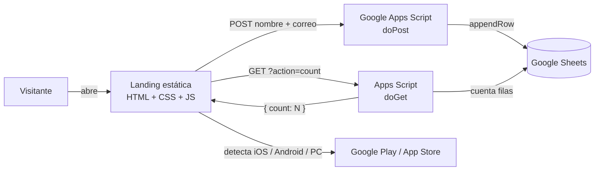

<div align="center">

# 🛰️ GeoRescate — Landing Page

**Landing page responsiva para un sistema de gestión de emergencias que transmite el GPS exacto y la ficha médica vital de una persona a las centrales de rescate.**


</div>

---


## 🎯 ¿Qué problema aborda?

En una emergencia, hablar o escribir puede ser imposible. GeoRescate propone enviar de forma automática la **ubicación exacta**, la **identidad verificada** y los **datos médicos críticos** (tipo de sangre, alergias) a SAMU y Bomberos, incluso sin conexión a internet (vía SMS cifrado).

Esta landing presenta el producto y cumple dos objetivos de negocio:

1. **Captar usuarios** para la lista de espera del **Panel Web**.
2. **Dirigir la descarga** de la **app móvil**, que ya es pública.

## ✨ Funcionalidades

- **Diseño responsivo real**: probado desde 350 px de ancho hasta pantallas de escritorio, en Android, iOS y PC.
- **Lista de espera conectada a Google Sheets**: el formulario guarda nombre, correo y fecha en una hoja de cálculo, sin servidor propio.
- **Contador de inscritos en vivo**: la página consulta la cantidad real de registros y la muestra, actualizándose al inscribirse alguien.
- **Botón inteligente "Obtener app móvil"**: detecta el sistema del visitante. En iPhone abre App Store, en Android abre Google Play y en PC muestra un selector con ambas tiendas.
- **Animaciones**: efecto de partículas en `<canvas>`, revelado de secciones al hacer scroll (`IntersectionObserver`) y scroll suave personalizado.
- **Accesible**: etiquetas en los campos, mensajes con `aria-live`, foco visible y soporte de `prefers-reduced-motion`.
- **SEO y redes**: metadatos Open Graph / Twitter Card, favicon SVG y `theme-color`.

## 🧱 Arquitectura



No hay servidor ni base de datos que mantener: la página es estática y el "backend" es un Apps Script gratuito.

## 🛠️ Tecnologías

| Capa | Herramientas |
|---|---|
| Estructura | HTML5 semántico |
| Estilos | CSS3 puro: variables, Grid, Flexbox, `clamp()`, media queries, `env(safe-area-inset-*)` |
| Lógica | JavaScript vanilla (ES6+, `fetch`, `async/await`, `IntersectionObserver`, Canvas API). Sin dependencias ni build |
| Tipografía | Inter (Google Fonts) |
| Backend | Google Apps Script |
| Almacenamiento | Google Sheets |
| Hosting | GitHub Pages (sitio estático) |

## 🧠 Decisiones técnicas

- **Sin frameworks**: es una landing, así que prioricé carga rápida y cero dependencias.
- **Mobile first en la práctica**: inputs de 16 px para evitar el zoom automático de iOS, `100svh` para la barra de direcciones móvil, zonas seguras del notch y botones táctiles de al menos 46 px de alto.
- **Seguridad en capas** (ver sección siguiente), pensando en que el repositorio es público.
- **Configuración centralizada**: todo lo editable (URL del backend, links de tiendas, contador de respaldo) está en un único bloque `CONFIG` de `script.js`.
- **Degradación elegante**: si el backend no responde, el contador muestra un valor de respaldo y el formulario informa el error en lugar de fallar en silencio.
- **Correcciones sobre el diseño original**: menú que se desbordaba en celular, control "deslizar" mal anidado dentro del botón SOS y clases de utilidad sin su framework.

## 🔐 Seguridad y privacidad

- Este repositorio **no contiene claves, tokens ni datos personales**.
- La URL del Apps Script es pública por naturaleza (toda página que envía formularios la expone). Solo permite **agregar una inscripción** o **leer el total**; no da acceso a los datos guardados, que viven en una hoja privada.
- **Content-Security-Policy** restrictiva: solo permite conexiones a `script.google.com` y fuentes de Google.
- **Anti-bots**: campo trampa (*honeypot*).
- **Validación doble**: en el navegador y en el servidor.
- **Protección de la hoja**: límite de largo de campos, neutralización de inyección de fórmulas (`=`, `+`, `-`, `@`) y filtro de correos duplicados.
- `.gitignore` bloquea `.env`, `.xlsx` y `.csv` para evitar subir listas de inscritos por accidente.

## 📁 Estructura

```
├── index.html          # Página completa
├── styles.css          # Estilos y diseño responsivo
├── script.js           # Configuración, formularios, contador, botón de app, animaciones
├── favicon.svg
├── og-image.png        # Imagen al compartir en redes
├── docs/               # Capturas usadas en este README
└── backend/
    └── Code.gs         # Google Apps Script (se pega en Google, no corre en la web)
```

## 🚀 Cómo ejecutarlo

**En local:** descarga el proyecto y abre `index.html` en el navegador. No requiere instalar nada.

**Con tu propio backend:**

1. Crea una hoja en Google Sheets con la fila 1: `Fecha | Nombre | Correo`.
2. **Extensiones → Apps Script**, pega el contenido de [`backend/Code.gs`](backend/Code.gs).
3. **Implementar → Nueva implementación → Aplicación web** (ejecutar como *Yo*, acceso *Cualquier persona*) y copia la URL `/exec`.
4. En `script.js`, edita el bloque `CONFIG`:

```js
const CONFIG = {
  scriptURL: 'https://script.google.com/macros/s/XXXX/exec',
  appLinks: { android: '', ios: '' },   // links de Google Play y App Store
  fallbackCount: 46
};
```

**Publicar:** en GitHub, *Settings → Pages → Deploy from a branch → `main` / root*.

## 🗺️ Próximas mejoras

- [ ] Política de privacidad y aviso de uso de datos
- [ ] Verificación de correo (doble opt-in)
- [ ] Versión en inglés
- [ ] Optimización de imágenes y métricas de rendimiento (Lighthouse)
- [ ] Panel interno para ver estadísticas de inscripción


<sub>Proyecto de portafolio. Todos los derechos reservados salvo que se indique otra licencia.</sub>
